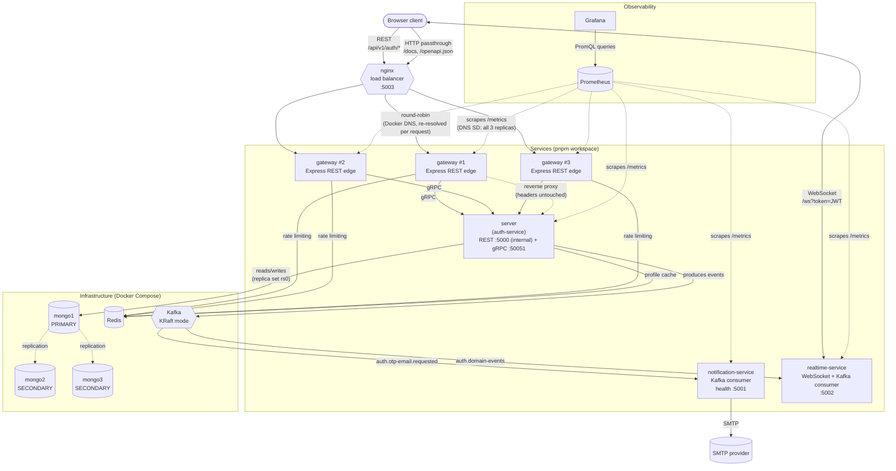
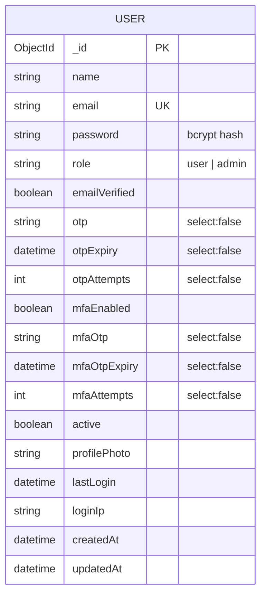
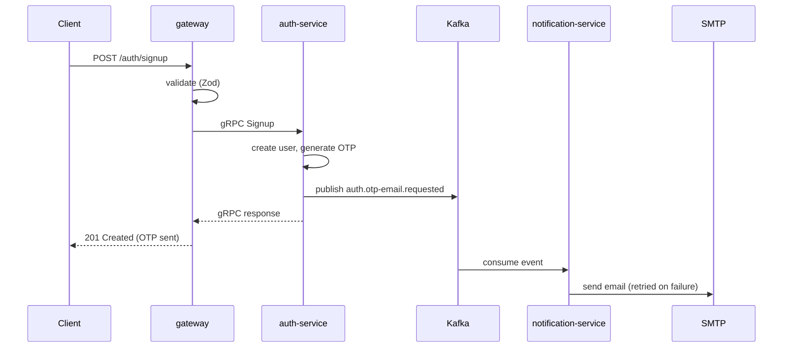
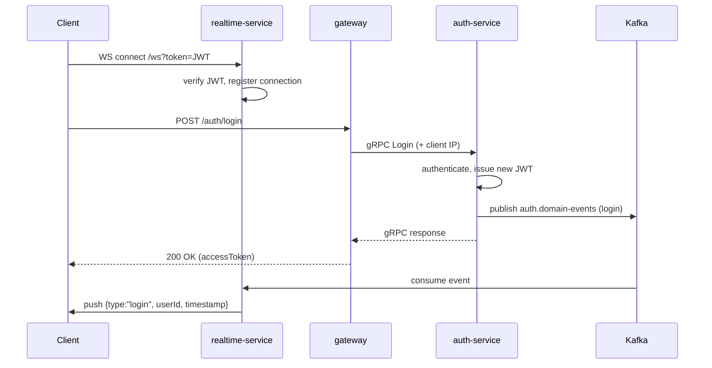

# Architecture

A technical overview of what this project actually is: the services, how they talk to each
other, the data model, the event flows, and the security measures in place.

- For **setup instructions**, see [README.md](README.md).
- For **what's been built vs. what's planned**, see [ROADMAP.md](ROADMAP.md).
- For the **full REST API reference** (every request/response shape), see `/docs` on the running
  `server` — it's generated live from the Zod validators, so it can't drift from the real
  behavior the way a hand-written copy in this file would.

## What this is

A MERN-stack authentication system (JWT, email OTP verification, MFA, profile management) built
as a small set of cooperating microservices rather than a single monolith: a REST-facing
`gateway` that talks gRPC to the internal `server` (auth-service), with async work (sending
email, pushing real-time notifications) handled by dedicated Kafka-consuming workers instead of
blocking the request path.

## System architecture

`nginx` is the only thing the browser ever talks to directly, publishing the port
(`GATEWAY_PORT`, `5003`) the client already pointed at. It load-balances across `gateway`'s
`${GATEWAY_REPLICAS:-3}` replicas — Docker Compose's `deploy.replicas` (works outside Swarm mode
with modern Compose), all sharing the DNS name `gateway`, which Docker's embedded DNS
(`127.0.0.11`) round-robins across. `nginx.conf` deliberately re-resolves that name per request
(`resolver` + a variable `proxy_pass`, not a static `upstream{}` block that would resolve once
at nginx startup and stick to one replica) so it actually spreads load across all of them.
`gateway` itself never touches Mongo/Redis-for-data or Kafka — it's a pure edge: REST in, gRPC
out to `server` (plus a transparent HTTP reverse proxy for `/docs`/`/openapi.json`, since those
are inherently HTML/HTTP, not something worth reinventing over gRPC). `server` never talks to
`notification-service` or `realtime-service` directly either — it only publishes events to Kafka
and moves on. Neither worker has an inbound HTTP API beyond a `/health` check
(`realtime-service`'s only other inbound surface is the WebSocket upgrade, which — for now — the
browser connects to directly, not through nginx/gateway). This is deliberate: it keeps
`server`'s request latency independent of SMTP round-trip time and independent of whether anyone
is currently connected over WebSocket. `server` connects to a 3-node MongoDB replica set
(`rs0`) rather than a single node — `mongo1`/`mongo2`/`mongo3`, one elected primary at a time,
the other two continuously replicating from it. This buys automatic failover: if the primary
dies, the remaining two elect a new one within seconds and `server`'s existing connection
(`serverSelectionTimeoutMS: 5000`) rides it out with no restart, verified by killing the primary
mid-session and confirming a write went through against the newly elected one. Every service
exposes a `/metrics` endpoint that Prometheus scrapes; `gateway`'s is the interesting one —
since it's 3 replicas sharing one DNS name, a plain static scrape target would only ever reach
whichever single replica happened to resolve first, so Prometheus uses DNS-based service
discovery instead, resolving all 3 replica IPs and scraping each independently (the same
"round-robin resolves to one, not all" problem `nginx.conf`'s `resolver` directive solves for
load balancing, mirrored on the scraping side). Grafana queries Prometheus and renders the
result; nothing scrapes Grafana or is scraped by it directly.

## Services

### `nginx` — load balancer

`nginx:1.27-alpine`, unmodified image, one static `nginx.conf` mounted read-only. Publishes the
public port and round-robins across `gateway`'s scaled replicas (see above for why it re-resolves
DNS per request instead of using a static `upstream{}` block). Its own container healthcheck
probes `/nginx-health` — deliberately *not* `/health`, which would shadow `gateway`'s real
`/health` route (a bug hit and fixed while verifying this phase: `/health` was briefly
unreachable through the LB because nginx's own synthetic response answered it first).
`depends_on: [gateway]` is a start-order hint only (no `condition: service_healthy`) — a real
load balancer should tolerate backends not being up yet at its own startup, not require them
pre-synchronized.

### `gateway/`

The sole public entry point for application traffic (behind `nginx`). Express REST app with the
*exact* request/response shapes and error envelope `server`'s REST API used to expose directly —
the browser client sees no difference beyond the port. Internally: Zod-validates the request,
then calls `server` over gRPC (`grpc/client.ts`) instead of touching a database or business logic
itself. JWT verification also lives here now — the already-authenticated `userId` is what crosses
the gRPC boundary; `server` trusts it because gRPC is only reachable within the Docker network,
never from the browser. Owns rate limiting, CORS, and `express-mongo-sanitize` too — this is the
real edge now, so that's where those belong. Runs as `${GATEWAY_REPLICAS:-3}` stateless replicas
behind `nginx`; nothing in it holds in-process state that would break under horizontal scaling
(rate-limit counters live in Redis, not memory).

### `server/` — auth-service

Owns the user data model, authentication, and MFA — the only service that touches MongoDB.
Express 5 + TypeScript + Mongoose + Zod, **plus** a `@grpc/grpc-js` server (`grpc/server.ts`,
port `50051`) that `gateway` is the only caller of. Its REST API and `/docs` still run
internally (unpublished in Docker) purely so `gateway` has something to reverse-proxy `/docs`
to — no route on it is meant to be hit directly anymore. The 12 gRPC methods are thin wrappers
around the same `services/auth.service.ts` functions the (now-unused-externally) REST
controllers call — no business logic exists twice.

- Structured logging via Pino (`config/logger.ts`), request logging via `pino-http`.
- Publishes to Kafka via `config/kafka.ts` / `utils/domainEvents.ts` / `utils/otpHelper.ts`;
  never consumes.
- Serves interactive API docs at `/docs` (Scalar), generated from `openapi/` + the Zod schemas
  in `validators/` — reachable through `gateway`'s proxy.

### `mongo1` / `mongo2` / `mongo3` — replica set

Unmodified `mongo:7` image, each started with `mongod --replSet rs0 --bind_ip_all`. A one-shot
`mongo-init` service (`mongo/init-replica-set.js`, mounted read-only) runs `rs.initiate()`
against `mongo1` once all three report healthy — idempotent (checks `rs.status()` first and
skips if already initialized), so it's safe to run on every `docker compose up`, restarts
included. `server`'s `MONGO_URI` is a multi-host `mongodb://mongo1:27017,mongo2:27017,mongo3:27017/?replicaSet=rs0`
connection string; the Mongo driver auto-discovers the replica set topology from those seeds and
tracks the current primary itself, so `server` never needs to know or care which node is
primary at any given moment. `directConnection` is deliberately unset on the Mongoose connection
options (`server/config/connectDB.ts`) and the `migrate-mongo` config — it's incompatible with a
multi-host URI.
- Database migrations live in `migrations/`, run via `migrate-mongo` (`pnpm migrate:*`).

### `notification-service/`

A pure Kafka consumer with no HTTP API (beyond `/health`). Subscribes to
`auth.otp-email.requested`, renders the OTP email template, and sends it via Nodemailer with
retry-with-backoff. Owns all SMTP configuration — `server` has none.

### `realtime-service/`

A Kafka consumer paired with a WebSocket server (`ws`). Subscribes to `auth.domain-events`;
for each event, looks up the target user's open WebSocket connection(s) in an in-memory
`Map<userId, Set<WebSocket>>` registry and pushes the event, if any connection is open. A client
connects directly to `ws://<host>/ws?token=<JWT>` (not through `gateway` — see roadmap) — the
same JWT issued by `server`'s login endpoints, verified here with the identical secret and
payload shape. No connection is registered until the token verifies.

### `client/`

React 19 + Vite frontend. Talks to `gateway` over REST (`VITE_API_URL`); not yet wired to
`realtime-service`'s WebSocket (the backend capability exists — see [ROADMAP.md](ROADMAP.md) —
but nothing in the client opens a connection to it yet).

### `prometheus`

Unmodified `prom/prometheus` image, one static `prometheus.yml` mounted read-only (same
non-templated-file rationale as `nginx.conf` and `mongo/init-replica-set.js` — targets are bare
service names). Scrapes `server`, `notification-service`, `realtime-service` as single static
targets, and `gateway` via `dns_sd_configs` (see above) to cover all replicas. Data persists in
a named volume (`prometheus_data`) across restarts.

### `grafana`

Unmodified `grafana/grafana` image. Auto-provisions on boot from `grafana/provisioning/` (a
Prometheus datasource, fixed `uid: prometheus` so the dashboard JSON can reference it directly)
and loads `grafana/dashboards/overview.json` — a 12-panel dashboard covering gateway replica
count, HTTP/gRPC/Kafka rates and latencies, process memory, and event loop lag across all four
services. Admin credentials are env-driven (`GRAFANA_ADMIN_USER`/`GRAFANA_ADMIN_PASSWORD`,
default `admin`/`admin`); its own state (users, sessions, any dashboard edits made through the
UI rather than the provisioned file) persists in a named volume (`grafana_data`).

## Data model

A single collection today — everything (auth, OTP state, MFA state, profile) lives on the
`User` document (`server/models/user.model.ts`):

`otp`/`mfaOtp` and their expiry/attempt fields are `select: false` — excluded from normal
queries, only pulled in explicitly (`.select("+otp +otpExpiry +otpAttempts")`) where the OTP
verification flow needs them. `email` carries the collection's one enforced index (unique,
explicitly migrated — see [Database migrations](#database-migrations)).

## API surface

All routes are under `/api/v1/auth`, served by `gateway` (`server`'s copy of the same routes is
no longer reachable from outside the Docker network). Full request/response schemas, generated
from the same Zod validators the routes actually enforce, are at `/docs` (proxied through
`gateway`) — this table is just an index.

| Method | Path | Auth | Purpose |
|---|---|---|---|
| POST | `/signup` | — | Create an account, email an OTP |
| POST | `/verify-signup` | — | Verify OTP, activate the account, get a session |
| POST | `/login` | — | Log in; returns a session or `mfaRequired: true` |
| POST | `/forgot-password` | — | Email a password-reset OTP |
| POST | `/verify-otp` | — | Verify a password-reset OTP |
| POST | `/reset-password` | — | Set a new password after OTP verification |
| POST | `/mfa/verify-login` | — | Complete login with an MFA OTP |
| POST | `/mfa/toggle` | Bearer | Request enabling/disabling MFA (emails an OTP) |
| POST | `/mfa/verify-toggle` | Bearer | Confirm the MFA toggle |
| GET | `/profile` | Bearer | Get the current user's profile (Redis-cached) |
| PATCH | `/profile` | Bearer | Update name/profile photo |
| POST | `/deactivate` | Bearer | Deactivate the current account |

Every response — success or error — follows the same envelope. Errors are
`{ status: "fail" | "error", message, errors?: [{ field, message }] }`, where `status` is
`"fail"` for 4xx (the client's fault) and `"error"` for 5xx; `errors` is only present for
per-field validation failures.

## Event-driven architecture

Two Kafka topics, both produced only by `server`, each consumed by exactly one worker. Topics
are provisioned explicitly via the Kafka Admin API at each service's startup — not left to
`auto.create.topics.enable`, which only triggers on produce, not on a consumer's `subscribe()`
(a worker starting before anything was ever produced would otherwise crash on
`UNKNOWN_TOPIC_OR_PARTITION`).

| Topic | Producer | Consumer | Payload | Delivery semantics |
|---|---|---|---|---|
| `auth.otp-email.requested` | `server` | `notification-service` | `{ email, otp, subject }` | Fails closed — a publish error fails the HTTP request, since the user has no other way to get the OTP |
| `auth.domain-events` | `server` | `realtime-service` | `{ type, userId, timestamp, ...extra }` | Best-effort — a publish error is logged and swallowed; the underlying operation already succeeded in the DB by the time it's published |

`auth.domain-events` carries four event types, published from `services/auth.service.ts`
alongside each operation's own `save()`/cache-invalidation calls — `login`'s and
`verifyMfaLogin`'s orchestration (password check, MFA branch, tracking, token issuance, event
publish) lives in shared functions (`performLogin`, `performMfaLoginVerification`) so both the
REST-via-gRPC path and any future caller publish the exact same event the exact same way:

| `type` | Published from | Extra fields |
|---|---|---|
| `login` | `auth.service.ts` → `performLogin` / `performMfaLoginVerification` | `loginIp` |
| `mfa.toggled` | `auth.service.ts` → `verifyMFAToggle` | `mfaEnabled` |
| `password.reset` | `auth.service.ts` → `resetUserPassword` | — |
| `account.deactivated` | `auth.service.ts` → `deactivateAccount` | — |

### OTP email flow

### Real-time push flow

## Internal RPC (gRPC)

`gateway` calls `server` over gRPC instead of REST — `proto/auth.proto` (repo root) defines one
`AuthService` with 12 RPCs, 1:1 with the REST routes above, loaded dynamically at runtime by
both sides via `@grpc/proto-loader` (no `protoc`/codegen build step). Request validation happens
once, at the gateway (Zod) — `server`'s gRPC handlers trust the shape they receive and focus
only on business-level failures (not found, wrong password, expired OTP, etc.).

Those business failures still flow through the same `AppError` class the REST side always used;
a small boundary layer translates between the two error models so neither side needs to know
the other protocol exists:

| | `server/grpc/errorMapping.ts` | `gateway/grpc/errorMapping.ts` |
|---|---|---|
| Direction | `AppError` → gRPC `status` code | gRPC error → `AppError` |
| `AppError(msg, 400)` | `INVALID_ARGUMENT` | ← |
| `AppError(msg, 401)` | `UNAUTHENTICATED` | ← |
| `AppError(msg, 403)` | `PERMISSION_DENIED` | ← |
| `AppError(msg, 404)` | `NOT_FOUND` | ← |
| `AppError(msg, 409)` | `ALREADY_EXISTS` | ← |
| anything else | `INTERNAL` | ← |

A `gateway` controller that calls `callAuthService(...)` and gets a rejection is already holding
a normal `AppError` by the time it sees it — `errorHandler.ts` treats it exactly like a
validation failure or any other operational error, same envelope as before gRPC existed.

## Security

- **Transport/response headers** — `helmet` on both `gateway` and `server`, with a strict
  `Content-Security-Policy` in production. Only `server` needs a CSP nonce (for the Scalar docs
  page's inline `<script>`, generated once at startup) — `gateway` reverse-proxies `/docs`
  *before* its own `helmet` middleware runs, so the proxied response's headers (including
  `server`'s nonce) pass through untouched instead of being overwritten by a mismatched one.
- **Input handling** — Zod validation on every route that takes a body, now enforced at
  `gateway` (`middlewares/validate.ts`, schemas in `validators/`) rather than `server`, plus
  `express-mongo-sanitize` on `body`/`params` as defense-in-depth against NoSQL operator
  injection. (`req.query` is deliberately not sanitized: Express 5 made it a getter with no
  setter, so the sanitizer's default reassignment would throw — moot anyway since no route reads
  `req.query`.)
- **Passwords** — bcrypt (cost configurable via `BCRYPT_ROUNDS`), one Zod rule enforced in one
  place (8+ chars, upper/lower/number/special) — not duplicated between the schema and a
  separate runtime check.
- **Sessions** — stateless JWT bearer tokens. Verification now happens at `gateway`
  (`middlewares/auth.ts`) rather than `server` — the verified `userId` is what crosses the gRPC
  boundary, which `server` trusts since gRPC is only reachable within the Docker network.
  `realtime-service` verifies independently for its own WebSocket connections. All three that
  verify tokens must share the exact same `JWT_SECRET`. No refresh-token flow yet — a single
  token with `JWT_EXPIRES_IN`.
- **Rate limiting** — Redis-backed, fixed-window, atomic (one Lua `EVAL` per request covering
  the increment, self-healing `PEXPIRE ... NX`, and TTL read — not 3 sequential round-trips),
  solely enforced at `gateway` (`server` has none of its own — see Known gaps history — since
  gRPC traffic never passes through Express middleware and `server`'s REST port isn't published).
  Three independently-namespaced limiters share the underlying Redis key prefix pattern
  (`ratelimit:<name>:<ip>`) but never the same key: general API traffic, the stricter `/auth/*`
  limit (`AUTH_RATE_LIMIT_MAX`), and `/docs`+`/openapi.json` — each has its own budget.
- **OTPs** — 6 digits, time-limited (`OTP_EXPIRY_MINUTES`), attempt-limited
  (`OTP_MAX_ATTEMPTS`) with lockout on exhaustion.
- **Error responses** — never leak stack traces or internal error messages in production; the
  unified envelope (see [API surface](#api-surface)) is the same shape whether the error came
  from Zod, Mongoose, or application code.

## Infrastructure

Everything runs in Docker Compose for local dev — no cloud-provider assumptions.

| Component | Image/tool | Notes |
|---|---|---|
| MongoDB | `mongo:7` | 3-node replica set (`rs0`), auto-failover. `autoIndex` is only on in dev; elsewhere, index changes go through `migrate-mongo` |
| Redis | `redis:7-alpine` | AOF persistence enabled |
| Kafka | `apache/kafka:3.9.1` | KRaft mode (no Zookeeper), dual listener — one for in-network containers, one published to the host for local `pnpm dev` |
| `server`, `gateway`, `notification-service`, `realtime-service` | Custom multi-stage `Dockerfile`s | Node 22-alpine, non-root user, `tini` as PID 1, health-checked |
| nginx | `nginx:1.27-alpine` | Unmodified image, static config volume-mounted; only service publishing a port to the host now besides `mongodb`/`redis`/`kafka`'s dev-convenience ports |
| Prometheus | `prom/prometheus:v3.14.0` | Unmodified image, static config volume-mounted; scrapes all 4 app services (`gateway` via DNS SD across its replicas) |
| Grafana | `grafana/grafana:13.2.1` | Unmodified image; auto-provisions the Prometheus datasource + one dashboard from files in `grafana/provisioning/` and `grafana/dashboards/` |

Every container name and host port is env-var driven (`.env.example` at the repo root) —
nothing is hardcoded in `docker-compose.yml` or the Dockerfiles.

`server` and `gateway` build from the **repo-root** Docker context (`context: .`), not their own
directory — the only two services whose image needs a file from outside their own folder
(`proto/`). `notification-service` and `realtime-service` still build from their own directory
context as before.

### Database migrations

Index/schema changes go through [migrate-mongo](https://github.com/seppevs/migrate-mongo)
(`server/migrations/`), not Mongoose's automatic index creation — see
[README.md](README.md#database-migrations) for the commands.

## Known gaps

Tracked in detail in [ROADMAP.md](ROADMAP.md); the short version:

- `realtime-service`'s WebSocket isn't behind `nginx`/`gateway` — the browser connects to it
  directly. Only the REST API and `/docs` are proxied through the gateway tier so far.
- No shared package between services — the Kafka topic-name constants, `TOPIC_OTP_EMAIL`/
  `TOPIC_AUTH_EVENTS`, `logger.ts`/`redis.ts`/`errorHandler.ts`/`AppError.ts`, and env var
  defaults/guards are hand-duplicated across `server/`, `notification-service/`,
  `realtime-service/`, and `gateway/`. This already caused a real bug once: the production
  guard against the placeholder `JWT_SECRET` existed only in `server/config/validateEnv.ts` and
  hadn't been copied to `gateway`/`realtime-service` — caught by a code review and fixed
  everywhere it was missing, but nothing stops the next fix from having the same gap. Same
  caveat for `proto/auth.proto`'s field shapes mirroring `server/validators/auth.schema.ts` —
  expected to stay in sync by hand, nothing enforces it.
- Each service's Docker build uses a standalone lockfile in its own directory, generated
  separately from the root `pnpm-workspace.yaml` lockfile — they can drift from what's actually
  resolved in local dev, and already broke a build once (`server`'s lockfile didn't have the
  gRPC deps `pnpm install` added at the workspace root). The correct fix is a workspace-aware
  build (`pnpm deploy`); see [ROADMAP.md](ROADMAP.md) for why it hasn't been done yet.
- Metrics exist (Prometheus + Grafana, Phase 5a) but not distributed tracing yet (Phase 5b) —
  a cross-service request (gateway → server → Kafka → notification-service/realtime-service)
  can be measured at each hop independently but not followed as one connected trace end to end;
  correlating a specific slow request across services still means reading each service's logs
  separately.
- No infra-level exporters (`mongodb-exporter`, `redis-exporter`, `kafka-exporter`) — Prometheus
  currently only scrapes the 4 application services, not MongoDB/Redis/Kafka themselves.
